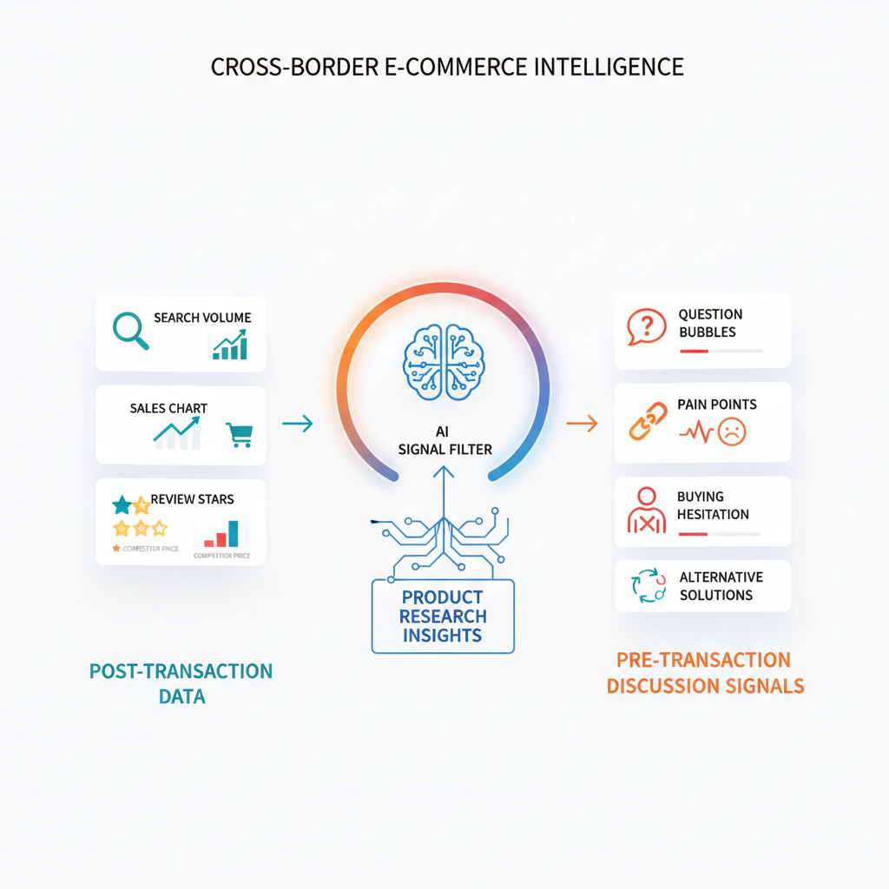

# 跨境选品别只看亚马逊数据：用 Reddit 提前发现用户需求【送 Skills】

> 4.21 - 5.20  
> 日更 30 天，分享 30 个 AI + 跨境电商深度应用和场景。  
>  
> 关注公众号并回复「小助手」，扫码进 AI 交流群，围观 + 交流。

**本期福利：**  
「Reddit 市场监控 Skills + 配置模板 + AI 眼镜配件监控案例」免费领取，具体方式详见文末。

---


---

最近我查了几个微信指数，发现一个很有意思的现象：

`跨境选品`、`亚马逊选品`、`亚马逊运营` 这些词热度很高，说明大家仍然在找新品、找机会、找增长方法。

但另一个词 `Reddit` 也有不小的搜索热度。

这背后其实指向一个变化：**跨境卖家不只是想知道“亚马逊上什么卖得好”，也开始关心“海外用户到底在真实社区里讨论什么”。**

很多卖家做跨境选品、亚马逊选品和产品迭代，习惯盯三类数据：

- 亚马逊搜索量有没有涨；
- 竞品销量有没有动；
- Review 里有没有新差评。

这些数据当然重要，但它们有一个共同问题：

> 等你看见的时候，事情往往已经发生了。

搜索量起来了，说明已经有人开始教育市场；竞品销量动了，说明对手已经在吃需求；Review 爆出问题，说明用户已经付费、踩坑、退货，甚至给你留下差评了。

所以我最近越来越强烈地感受到，跨境电商不能只看「交易后的数据」，还要看「交易前的讨论」。

而 Reddit，就是一个很典型的交易前信号源。

用户会在里面问：

- 这东西值不值得买？
- 有没有替代方案？
- 哪个品牌更靠谱？
- 有没有人遇到同样的问题？
- 有没有什么配件能解决这个痛点？

这些话，往往比一条五星 Review 更接近真实需求。

因为 Review 是购买后的评价，而 Reddit 里很多讨论，是用户还没买、正在犹豫、正在抱怨、正在找解决方案的时候说出来的。

这就是这次这个 Skills 的起点：

> 不要把 Reddit 当成热帖搬运平台。  
> 要把它当成一个产品开发和运营决策的早期信号系统。

---

## 01 从「看热帖」到「看需求」

过去我们做 Reddit 调研，通常是这样的：

1. 打开几个 subreddit；
2. 搜一下关键词；
3. 看几篇热帖；
4. 截图几条评论；
5. 凭感觉判断「好像有人需要这个」。

这套方式的问题很明显。

**第一，太随机。**  
今天看到什么，取决于你刚好搜了什么。

**第二，太碎片。**  
一条评论很有启发，但过两天就找不到了。

**第三，太难复用。**  
你今天得出的判断，下次换个人做，又要从零开始看。

**第四，太容易误判。**  
一条高赞吐槽，可能只是情绪；一条低赞评论，反而可能是真正的产品机会。

所以 Reddit 调研真正需要的，不是更勤奋地刷帖子，而是一套标准化机制：

> 把社区、关键词、评论、用户原声、业务判断和长期记忆连起来。

我把它总结成一个公式：

```text
Reddit 市场情报 = subreddit 来源 x 关键词桶 x 用户原声 x 业务转译 x 长期记忆
```

少了 subreddit 和关键词桶，你不知道该看哪里。

少了用户原声，你只是在概括，不是在理解用户。

少了业务转译，你只是内容搬运，不是产品决策。

少了长期记忆，你每次都在重新开始。



---

## 02 这个 Reddit Skills 到底做什么？

这次整理的项目叫：

```text
reddit-market-monitor
```

GitHub 地址：

```text
https://github.com/WaytoAIC/reddit-market-monitor
```

它是一个面向 Codex / OpenClaw 的 Reddit 市场监控 Skill。

一句话解释：

> 它不是帮你「搬运 Reddit 热帖」，而是帮你把 Reddit 讨论变成产品开发、运营动作、竞品观察、用户原声存档和日报/周报。

它能做的事情包括：

- 监控指定 subreddit；
- 按关键词搜索帖子；
- 读取高价值评论线程；
- 识别用户痛点、功能诉求、购买顾虑、竞品对比、替代做法；
- 把信号转成产品动作、Listing 文案、FAQ、客服话术、内容选题、红人 Brief；
- 沉淀长期 VOC 用户原声；
- 输出中文优先的日报、周报和多组总览。

这里最关键的一点是：**它默认是只读的。**

只浏览、搜索、读取评论，不发帖、不评论、不点赞、不做任何 Reddit 账号交互。

这点很重要，因为我们做的是市场情报和用户洞察，不是自动化灌水。

---

## 03 核心机制：一个任务，一个配置

很多工具一上来就想做成大而全：

- 监控所有社区；
- 抓所有关键词；
- 分析所有竞品；
- 最后输出一份很长的报告。

但这种报告通常没法用。

因为不同业务目标混在一起，最后每条信息都像有点用，但又不知道该给谁执行。

所以这个 Skill 里有一个很重要的规则：

> 一个监控任务，对应一个 config。

比如：

- 你想监控 AI 眼镜配件，就单独建一个配置；
- 你想监控 Stanley 杯配件，就另建一个配置；
- 你想监控某个竞品品牌的用户流失原因，也另建一个配置。

每个配置里再定义：

- 监控目标是什么；
- 目标用户是谁；
- 重点看哪些 subreddit；
- 关键词分成哪些桶；
- 报告要服务什么决策；
- 什么样的用户原声值得长期存档。

这其实不是技术细节，而是业务纪律。

因为 AI 要想输出稳定，前提不是提示词写得花，而是上下文边界清楚。

---

## 04 核心机制：不只抓帖，更要抓评论

Reddit 里最有价值的内容，很多时候不是主帖标题，而是评论区。

标题通常是问题：

- 「这个产品值不值得买？」
- 「有人遇到这个问题吗？」
- 「有没有更好的替代方案？」

但评论区会出现真正的用户语言：

- 我为什么后悔买；
- 我为什么推荐另一个品牌；
- 我用了什么土办法解决；
- 我觉得哪个细节最烦；
- 我其实愿意为哪个功能多付钱。

这些话，是可以直接进入产品定义、Listing、FAQ 和客服话术的。

所以这个 Skill 的设计里，评论不是附属信息，而是 VOC 资产。

它会尽量保留 `exact_quote`，也就是用户原话；同时生成 `normalized_quote`，用于查重和聚类。如果同一类表达重复出现，就升级为主题记忆；如果同一条原声被多个监控组命中，就归并到同一个 archive 里，不重复建档。

这件事看起来很小，但长期价值很大。

因为你沉淀的不是「今天看过什么帖子」，而是：

> 这个市场里，真实用户反复说过什么话。

---

## 05 核心机制：信号必须转成动作

很多调研报告最大的问题，是只停留在总结层：

- 用户觉得不舒服；
- 用户担心续航；
- 有人提到竞品；
- 评论区争议比较多。

这些话不能说错，但它们不能直接指导行动。

真正有用的报告，必须回答下一步做什么。

所以这个 Skill 会把 Reddit 信号翻译成几个业务落点：

**产品开发动作**  
该不该做新 SKU？该验证结构、材质、兼容性，还是先做小样？

**运营动作**  
该改主图、A+、FAQ、说明书，还是客服话术？

**竞品观察**  
用户喜欢竞品什么？讨厌竞品什么？为什么迁移？

**内容动作**  
哪些用户原话可以变成短视频选题、红人 Brief、广告创意？

**差评预防**  
哪些误解如果不提前解释，未来大概率会变成 Review 风险？

这也是我做这个 Skills 时最在意的部分：

> 不是让 AI 帮你看更多内容，而是让 AI 帮你更快判断哪些内容值得行动。

---

## 06 实战案例：AI 眼镜配件监控

最近我用它跑了一轮 AI 眼镜配件市场监控，重点看 Ray-Ban Meta、SmartGlasses、Xreal 等相关社区。

最后输出不是「今天 Reddit 有哪些热门讨论」，而是一组可以直接讨论的决策卡。

**信号 1：电池扩展件**

- **Reddit 信号：**用户确实想要更长续航，但现有第三方方案出现压鼻梁、触点不适、胶粘失效、充电不稳定等反馈。
- **业务判断：**这是有需求但高差评风险的方向。
- **建议动作：**不建议直接跟款，先做结构安全、佩戴压力、导电触点、原盒兼容验证。

**信号 2：鼻托替换包**

- **Reddit 信号：**用户丢失 nose pad 后，很难单独买替换件。
- **业务判断：**小耗材从舒适配件升级成售后缺口。
- **建议动作：**优先验证 universal fit nose pad replacement kit，多规格、低成本、可补件。

**信号 3：铰链 / 镜腿保护**

- **Reddit 信号：**Xreal 用户已经自制 3D 打印 brace，Ray-Ban 用户也在找小螺丝和维修路径。
- **业务判断：**结构保护不是想象需求，而是用户已经在 DIY。
- **建议动作：**验证非侵入式 hinge brace、temple sleeve、维护工具信息页。

**信号 4：热车 / 防晒霜 / 保养**

- **Reddit 信号：**用户把智能眼镜当普通太阳镜放车内，引发断裂和材质风险争议。
- **业务判断：**这是典型的使用教育缺口。
- **建议动作：**包装卡、FAQ、客服模板前置 hot car / sunscreen / cleaning care。

**信号 5：Blayzer fit**

- **Reddit 信号：**新框型用户反馈 arms loose、fit 调整、透明框摄像头可见性。
- **业务判断：**早期信号，还不足以单独立项。
- **建议动作：**继续监控 fit 关键词，先准备 fit guide 和镜腿调整内容。

注意，这里最有价值的不是「发现了一个新品机会」，而是把机会和风险放在一起看。

比如电池扩展件。

如果只看需求，它很诱人：用户嫌续航短，希望能多用几个小时。

但一旦看评论，你会发现真实风险：鼻梁压迫、触点不舒服、发热、电池健康、胶粘失效、原盒不兼容。

所以结论不是「马上做电池配件」，而是：

> 这是一个有需求但不能直接上架的高风险方向。

这类判断，才是 Reddit 监控真正有价值的地方。

---

## 07 适合监控什么？

这个 Skills 最适合五类场景。

**第一，新品方向验证。**  
比如你想做某个配件，但不知道是不是用户真实需要，就可以先监控相关 subreddit 和痛点关键词。

**第二，配件机会发现。**  
特别适合大单品周边，例如智能眼镜、户外水杯、游戏设备、咖啡机、露营装备、宠物用品等。

**第三，竞品口碑观察。**  
不是看竞品卖了多少，而是看用户为什么夸它、骂它、替换它。

**第四，Listing / FAQ / 客服素材积累。**  
很多用户原话，稍微整理一下，就是很好的 FAQ、A+ 文案、客服预案和广告表达。

**第五，差评风险前置。**  
很多差评不是产品一定有问题，而是用户预期没有被提前管理。Reddit 讨论能帮你更早看到这些误解。

---

## 08 不适合什么？

也要说清楚，这个 Skills 不是万能的。

它不适合：

- 用来判断精确销量；
- 直接替代 Amazon 数据；
- 用单条 Reddit 评论决定是否立项；
- 自动去 Reddit 互动；
- 做纯热点内容搬运。

它更像一个早期雷达：

> 帮你发现用户在真实语境里反复提到的问题；  
> 帮你把这些问题转成产品、运营和内容动作；  
> 帮你沉淀长期用户语言资产。

最终能不能立项，还要回到供应链、成本、专利风险、市场容量、Amazon 竞品和实际测试。

---

## 09 使用方式

**第一步，安装 Skills。**

Codex 用户可以使用：

```bash
curl -fsSL https://raw.githubusercontent.com/WaytoAIC/reddit-market-monitor/v1.0.0/install.sh | bash -s -- --target codex --ref v1.0.0 --repo WaytoAIC/reddit-market-monitor
```

OpenClaw 用户可以使用：

```bash
curl -fsSL https://raw.githubusercontent.com/WaytoAIC/reddit-market-monitor/v1.0.0/install.sh | bash -s -- --target openclaw --ref v1.0.0 --repo WaytoAIC/reddit-market-monitor
```

安装后重启 Codex / OpenClaw。

**第二步，先建一个最小配置。**

新手不要一上来监控十几个社区。建议先回答六个问题：

1. 你要监控什么产品 / 品类 / 竞品 / 场景？
2. 你关心哪类用户？
3. 你最想看哪些 subreddit？
4. 你要抓哪些关键词？
5. 你希望报告最后服务什么决策？
6. 哪些用户原声值得长期存档？

**第三步，让 Codex 跑监控。**

可以这样说：

```text
用 reddit-market-monitor，帮我监控 AI 眼镜配件市场。
先基于模板生成一个最小 config。
目标是发现可做成 Amazon 配件 SKU 的用户痛点、购买顾虑和竞品缺口。
报告用中文，表格优先，输出产品动作、运营动作和用户原声存档。
```

如果你已经有配置，可以直接说：

```text
用 reddit-market-monitor 按 configs/ai_glasses_accessories_market_watch.yaml 跑今天的日报。
重点看新增高价值信号、可执行动作、是否有需要入档的用户原声。
```

**第四步，看报告时不要只看摘要。**

重点看三块：

- 有没有可验证的新 SKU 机会；
- 有没有必须提前解释的差评风险；
- 有没有可以直接进入 Listing / FAQ / 客服 / 内容的用户原话。

这三块，才是 Reddit 数据真正能落地的地方。

---

## 10 为什么这也是一种 Skills？

最近我一直在反复讲一个观点：

> AI 真正落地，不是靠一次性提示词，而是靠可执行的业务上下文。

Skills 本质上不是「工具清单」，而是把你的判断方式、执行流程、输出标准和长期记忆写进系统。

比如 Reddit 监控这件事，如果只靠人手动做，每个人都会有自己的偏好：

- 有人喜欢看高赞帖；
- 有人喜欢看新帖；
- 有人只看标题；
- 有人会认真读评论；
- 有人把一句用户原话看成机会；
- 有人把同一句话当成噪音。

这就是为什么团队协作很难稳定。

而 Skills 要解决的，就是把这些判断规则沉淀下来：

- 什么样的信号值得进入报告；
- 什么样的原声值得存档；
- 什么情况下只能标记为观察；
- 什么时候要转成产品动作；
- 什么时候要转成运营动作；
- 什么时候要明确写「证据不足」。

当这些规则被写进系统后，AI 才不是一个随机聊天对象，而是一个可以持续复用的业务协作节点。

---

## 11 最后

很多人现在做 AI，还是停留在：

- 让 AI 帮我搜一下；
- 让 AI 帮我总结一下；
- 让 AI 帮我写一段。

但跨境电商真正需要的，不是更多总结，而是更早的信号、更稳定的判断、更可执行的动作。

Reddit 市场监控这个 Skills，解决的就是这个问题：

> 把零散的社区讨论，变成可复盘、可执行、可沉淀的市场情报系统。

你不一定每次都能从 Reddit 里挖出一个爆品。

但你会更早知道：

- 用户真正烦什么；
- 他们正在拿什么做替代；
- 他们为什么犹豫；
- 他们怎么看竞品；
- 他们愿意为什么功能买单；
- 哪些看起来很诱人的机会，其实一上架就可能变成差评风险。

这比单纯多看几个热帖有价值。

也比等到亚马逊数据变红以后再反应，要早得多。

---

**本期福利：**

关注公众号并回复「小助手」，领取：

- Reddit 市场监控 Skills；
- 配置模板；
- AI 眼镜配件监控案例；
- 以及后续更多 AI + 跨境电商真实业务场景 SOP。

GitHub 项目地址：

```text
https://github.com/WaytoAIC/reddit-market-monitor
```
